🌐 English &nbsp;·&nbsp; [🇷🇺 По-русски](./README_RU.md)

 

## 👋 About

- 🔭 Currently building **[pipeline-demo](https://github.com/linktheoperatormatrix/pipeline-demo)** — a code delivery pipeline: lefthook → GitHub Actions / GitLab CI → LLM code review with a hierarchy of subagents
- 🌱 Learning **Go** with a C and Java background — aiming to become a **software architect**
- 🗄️ Leveling up my SQL
- ⚡ Principle: deterministic checks are the foundation, LLMs are the judgment layer on top
- 📍 Live in [Zion](https://matrix.fandom.com/wiki/Zion "The last human city") — the last human city

## 📡 Operator's Bay

## 🛠️ Tech Stack

 

## 📊 Stats

 

## 🐍 Contribution Snake

<picture>
  <source media="(prefers-color-scheme: dark)" srcset="https://raw.githubusercontent.com/linktheoperatormatrix/linktheoperatormatrix/output/github-contribution-grid-snake-dark.svg" />
  <source media="(prefers-color-scheme: light)" srcset="https://raw.githubusercontent.com/linktheoperatormatrix/linktheoperatormatrix/output/github-contribution-grid-snake.svg" />
  
</picture>

## 🚀 Projects

